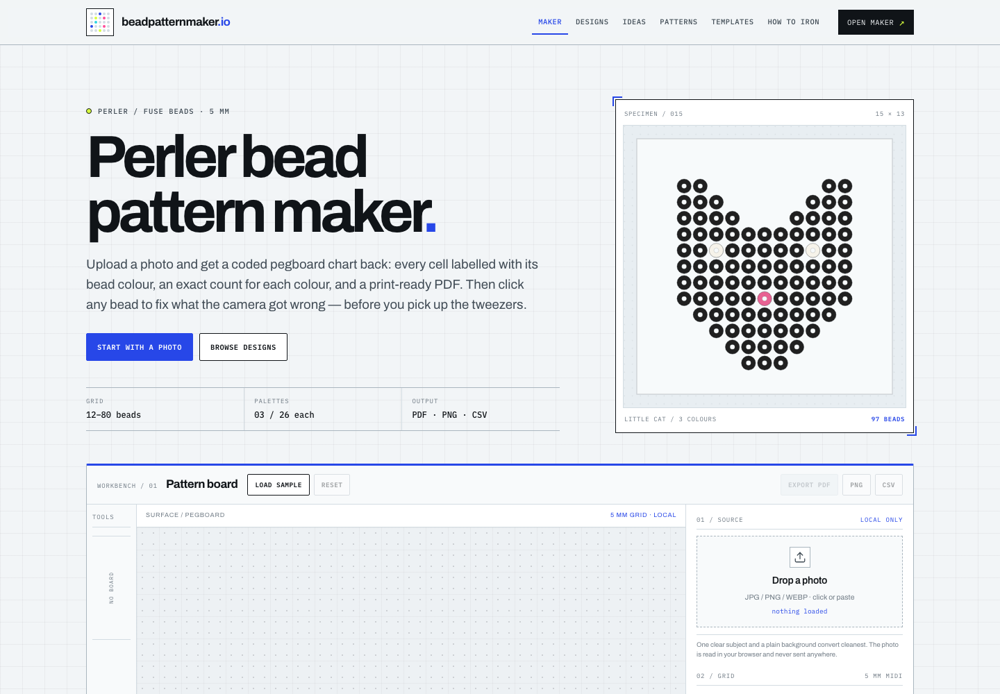
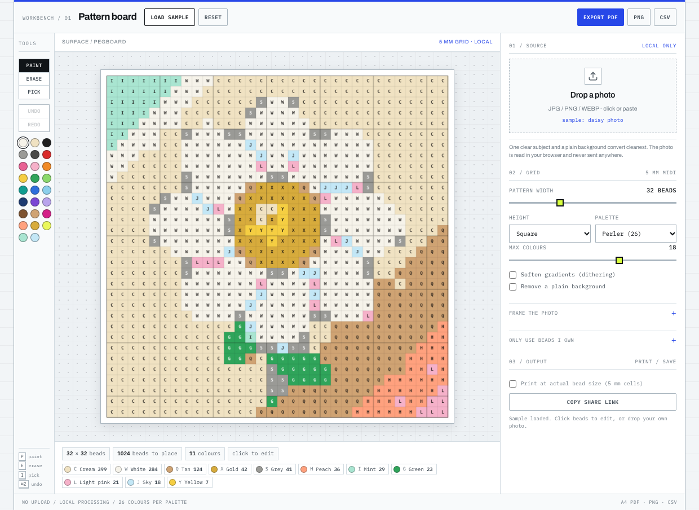

# beadpatternmaker.io

A complete, static **perler / fuse bead pattern site**: photo → coded chart →
print-ready PDF. Built with plain HTML, CSS and JavaScript. No framework, no
runtime build, no server-side photo processing.

The site is written for the `beadpatternmaker.io` domain (not registered in this
workspace). It shares only the generic engine modules with the older kandi
project — the quantiser, canvas renderer, PDF writer, share codec and crop maths.
The visual system, page structures, header/footer, workbench layout, cards and
marketing pages are purpose-built for this site.





## Visual system — Pegboard Workbench

The front end is deliberately not the warm-paper craft-blog look:

- **Cool technical grid** instead of a warm dotted paper background.
- **Archivo** for display/body and **IBM Plex Mono** for codes, metadata and
  controls. No serif display face.
- **Electric blue + lime** as functional colours; the bright bead palette is
  reserved for actual bead swatches and chart previews.
- A **full-width workbench** with a top command bar, a narrow tool rail, a large
  pegboard canvas, a right-hand inspector and a print/output strip. It is not
  the three-column card used by the kandi site.
- **Pattern plates** for cards: a numbered/spec header, square chart image,
  metadata row and compact action buttons.
- A dark **index-style footer** and a utility nav with an active underline.

The two sites now share an engine, not a skin.

## What it does

- **Upload a photo** (or paste / drag one in) and downsample it to one colour
  per bead.
- **Match to a real bead palette**: Perler, Hama and Artkal-style sets with 26
  colours each. Colours are matched in Lab space, not RGB.
- **Edit the chart**: paint, erase, pick, undo/redo, live bead counts, background
  removal, colour cap, crop/zoom framing, and a “beads I own” filter.
- **Export**:
  - coded chart PNG
  - A4 PDF with a code in every cell, heavier lines every 5 beads, optional
    actual-size 5 mm cells, and a final bead-list page
  - bead-list CSV
  - share link containing the whole chart
- **Browse 30 original designs** across animals, flowers, food, space, retro,
  holiday, 3D and cute themes. Each design has a preview, exact metadata and a
  printable PDF.
- **Print blank templates** in 10 × 10, 16 × 16, 20 × 20, 29 × 29, 48 × 48 and
  64 × 64 grids.
- **Read a real guide** to ironing perler beads, with troubleshooting and FAQ.

Everything runs client-side. Photos are never uploaded.

## Pages

| URL | Target | What it is |
| --- | --- | --- |
| `/` | perler bead pattern maker | The tool and homepage |
| `/perler-bead-designs/` | perler bead designs | Filterable gallery of 30 designs |
| `/fuse-bead-ideas/` | fuse bead ideas | Craft ideas + the same design library |
| `/fuse-bead-patterns/` | fuse bead patterns | Printable charts and PDF downloads |
| `/perler-bead-templates/` | perler bead templates | Six blank printable grids |
| `/perler-bead-maker/` | perler bead maker | Tool landing page |
| `/perler-bead-generator/` | perler bead generator | Generator landing page |
| `/fuse-bead-pattern-maker/` | fuse bead pattern maker | Hama-first tool landing page |
| `/how-to-iron-perler-beads/` | how to iron perler beads | Long-form guide + HowTo schema |
| `/404.html` | — | Not-found page |

## Run it locally

```bash
cd beadpatternmaker
python3 -m http.server 8901
open http://127.0.0.1:8901
```

Use a real HTTP server, not `file://`, because every link is root-absolute.

## Build

```bash
node tools/build.js       # pages, SVGs, PDFs, sitemap, manifest
node tests/selftest.js    # engine + generated-site checks
node tools/build-dist.js  # assemble ./dist and fail on broken local links
```

`tools/build.js` is the only generator. It writes:

- all 10 HTML pages (from the templates in that file)
- `assets/designs/*.svg` (30 previews)
- `assets/pdfs/*.pdf` (30 printable charts)
- `assets/templates/*.svg` + `assets/templates/*.pdf` (6 blank grids)
- `sitemap.xml`, `robots.txt`, `manifest.webmanifest`
- `assets/og-fallback.png` and the touch icon

`assets/og.png` is a branded screenshot generated from `tools/og.html` with
Chrome and is intentionally preserved across rebuilds. If it is deleted, the
build copies the generated fallback into its place so `og:image` never breaks.

To regenerate the social card after changing the brand:

```bash
"/Applications/Google Chrome.app/Contents/MacOS/Google Chrome" \
  --headless=new --disable-gpu --no-sandbox --hide-scrollbars \
  --user-data-dir=/tmp/bead-og --window-size=1200,630 \
  --screenshot="$PWD/assets/og.png" "file://$PWD/tools/og.html"
```

## Deploy

`wrangler.jsonc` is set up for Cloudflare Workers static assets:

```bash
node tools/build-dist.js
wrangler deploy
```

The canonical URLs, OG tags, sitemap and robots file all use
`https://beadpatternmaker.io`. Register the domain and attach it as a Custom
Domain before treating the canonical URLs as final.

## Architecture

```
index.html                  generated homepage / tool
perler-bead-designs/        generated gallery
fuse-bead-ideas/            generated gallery
fuse-bead-patterns/         generated chart library
perler-bead-templates/      generated template page
perler-bead-maker/          generated tool landing page
perler-bead-generator/      generated tool landing page
fuse-bead-pattern-maker/    generated tool landing page
how-to-iron-perler-beads/   generated guide
assets/                     generated previews, PDFs, icons, OG image
css/site.css                design system (hand-written)
js/palettes.js              Perler / Hama / Artkal palettes
js/quantize.js              Lab colour matching, dithering, palette reduction
js/render.js                canvas renderer for the editor
js/pdf.js                   dependency-free PDF writer (tiled charts + bead list)
js/share.js                 RLE share links
js/frame.js                 crop / zoom maths
js/patterns-data.js         30 original designs
js/app.js                   the tool UI
js/gallery.js               theme filter
js/site.js                  mobile nav + year
tools/build.js              static site generator
tools/og.html               social-card source
tools/build-dist.js         deploy folder + link checker
tests/selftest.js           engine + generated-site tests
```

The key separation is **palette data → quantiser → renderer → PDF writer**. The
PDF writer has no npm dependencies and produces a valid PDF 1.4 file with a
tiled chart and a bead-list page. The same modules run in Node for build-time
PDFs and in the browser for user exports.

## Content rules

- The 30 gallery designs are original charts, not copied artwork.
- The site uses the Perler, Hama and Artkal names descriptively only. It is not
  affiliated with any bead manufacturer, and the domain does not contain a
  manufacturer trademark.
- Colour hexes are screen approximations. The UI tells users to check a real
  bead before starting a large piece.
- Photos are processed in the browser and never uploaded.

## Notes / limits

- The palette codes are this site's own single-character references, not
  manufacturer SKUs. The colour names are common bead names, not official
  product codes.
- The PDF writer uses Helvetica base fonts and no compression. It stays small
  enough for the generated charts and is deliberately dependency-free.
- SVG previews are used for the gallery and image sitemap. If a raster image
  pipeline is added later, update `patternSvg()` and the image entries in
  `buildSitemap()` together.
- The template PDFs are blank grids, not pre-drawn shapes. That keeps the
  download useful for any design.
